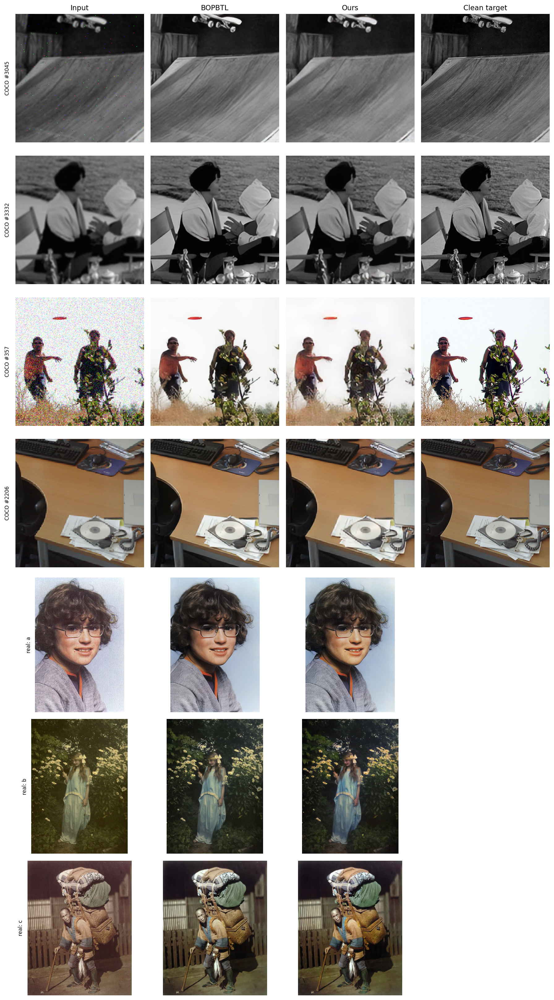

# A Lightweight Latent Mapping for Old Photo Restoration

Microsoft's [*Bringing Old Photos Back to Life*](https://github.com/microsoft/Bringing-Old-Photos-Back-to-Life) (BOPBTL) restores a photo in three steps:
1. a VAE encodes the damaged photo into a latent;
2. a **mapping network** turns it into the latent of a clean photo;
3. a second VAE decodes the result.

The mapping is the most expensive part. This project replaces it with a network that is **3.3× smaller and 2–3× faster**, trained with the same kinds of losses, and keeps everything else unchanged.

📄 **Paper:** [paper/paper.pdf](paper/paper.pdf)

It also shows that **flow matching is unnecessary** for this mapping. The same network trained as a flow never beats it trained as a direct regressor, at any number of sampling steps.

```
old photo ──► VAE A encoder ──► z_A ──► [ mapping ] ──► z_B ──► VAE B decoder ──► restored photo
                 (frozen)                                          (frozen)
              BOPBTL mapping: 36.1M parameters, 296 GFLOPs   →   ours: 10.9M parameters, 89 GFLOPs
```

## Results

The COCO benchmark has 4,958 synthetically degraded/clean pairs that were never used in training. Every mapping uses the same frozen VAEs, and outputs are evaluated raw.

| Mapping | Params | PSNR ↑ | SSIM ↑ | LPIPS ↓ | FID ↓ | KID×10³ ↓ | ΔE00 ↓ |
|---|---|---|---|---|---|---|---|
| Degraded input | – | 25.30 | 0.654 | 0.391 | 29.9 | 11.07 | 4.73 |
| BOPBTL mapping | 36.1M | **23.67** | **0.733** | **0.244** | **18.5** | **5.50** | **6.14** |
| **Ours (run 1)** | **10.9M** | 22.36 | 0.694 | 0.265 | 21.3 | 6.12 | 7.01 |
| Ours (run 2) | 10.9M | 22.25 | 0.687 | 0.291 | 23.1 | 7.12 | 7.05 |
| VAE ceiling (perfect mapping) | – | 25.32 | 0.882 | 0.065 | 6.3 | 1.29 | 6.03 |

- **Quality:** ours recovers **86% (run 1) and 68% (run 2) of BOPBTL's LPIPS improvement** over the degraded input, and 89% and 71% of its KID improvement. It is weaker in colour accuracy and pixel fidelity.
- **Speed** (Tesla T4): the mapping is **2.1× faster at batch 16 and 2.9× faster for single images**. The full pipeline is 1.7–2.5× faster.
- **Black-and-white photos:** ours adds as little false colour as BOPBTL (7.3% vs 7.4% visibly tinted pixels).
- **Real old photos** (8, no ground truth): ours scores slightly below BOPBTL on no-reference metrics (MUSIQ 63.6 vs 64.9).



### Is a flow needed?

| Same network, losses, data and budget | Network passes | LPIPS ↓ | KID×10³ ↓ |
|---|---|---|---|
| Direct regression (ours, 2 runs) | 1 | 0.265 / 0.291 | 6.12 / 7.12 |
| Bridge flow, 1 / 4 / 8 sampling steps | 1 / 4 / 8 | 0.338 / 0.327 / 0.322 | 8.26 / 8.64 / 8.88 |

**No.** Flows are designed to move one *distribution* onto another when it isn't known which input belongs to which output. Here every degraded photo comes with its clean original, so the problem is *point to point*.

A one-step flow only ever evaluates its network at t = 0. There, the time conditioning is a constant scale and shift, which folds exactly into the network's GroupNorm layers. Folding a trained flow network gives identical outputs ([`results/folding_check.json`](results/folding_check.json)), and its optimum equals that of direct regression. The [paper](paper/paper.pdf) has the details.

## Folder layout

| Path | Contents |
|---|---|
| `src/` | All code as Python modules |
| `notebooks/` | Google Colab notebooks, in the order to run them |
| `results/` | Result tables (CSV), figures, and the restored real photos |
| `paper/paper.pdf` | The paper |
| `requirements.txt` | Python dependencies |

### `src/`

| File | Purpose |
|---|---|
| `direct_model.py` | **The model** (`DirectMapping`), `load_direct()`, and `fold_rf()`, which converts a t = 0 flow network into it exactly |
| `train_direct.py` | Training: latent MSE + VGG19 + conditional multi-scale GAN + feature matching, BOPBTL's loss types |
| `train.py` | Command-line training of the model, or of the bridge flow for the ablation |
| `restore.py` | Command-line restoration of your own photos |
| `old_photo_model.py` | Wrapper around Microsoft's repository: the frozen VAEs and the original mapping; downloads the checkpoints |
| `degradation.py` | BOPBTL's synthetic degradation: blur, noise, downscaling, JPEG |
| `online_dataset.py` | Training pairs generated on the fly; a fixed validation split |
| `benchmark.py` | The COCO benchmark: PSNR, SSIM, LPIPS, FID, KID, CIEDE2000, VAE ceiling |
| `color_analysis.py` | Colour analysis in CIELAB: casts, saturation, hue drift, false colour on gray photos |
| `rf_model.py`, `train_rf.py` | The flow / bridge model and its trainer, used for the ablation |

### `notebooks/`

| Notebook | What it does | |
|---|---|---|
| `01_build_coco_benchmark.ipynb` | Builds the frozen COCO benchmark (once); scores the input, BOPBTL and the VAE ceiling | [Open in Colab](https://colab.research.google.com/github/Mani-Sankar-d/lightweight-old-photo-restoration/blob/main/notebooks/01_build_coco_benchmark.ipynb) |
| `02_train.ipynb` | Trains our model, or the bridge flow for the ablation (resumable) | [Open in Colab](https://colab.research.google.com/github/Mani-Sankar-d/lightweight-old-photo-restoration/blob/main/notebooks/02_train.ipynb) |
| `03_evaluate.ipynb` | Every number and figure: folding check, benchmark, ablation, efficiency, colour, real photos | [Open in Colab](https://colab.research.google.com/github/Mani-Sankar-d/lightweight-old-photo-restoration/blob/main/notebooks/03_evaluate.ipynb) |
| `04_inference.ipynb` | Restores your own photos with our mapping and BOPBTL's, side by side; no Google Drive needed | [Open in Colab](https://colab.research.google.com/github/Mani-Sankar-d/lightweight-old-photo-restoration/blob/main/notebooks/04_inference.ipynb) |

Notebooks 01–03 store data and checkpoints in a Google Drive folder (`ROOT` in each notebook).

Each notebook is self-contained: it writes the modules it needs, identical to `src/`, so it runs on a fresh Colab GPU runtime.

### `results/`

| File | Contents |
|---|---|
| `coco_benchmark.csv` | All models on the COCO benchmark, including a gray/colour split |
| `efficiency.csv` | Parameters, GFLOPs and ms per image (mapping and full pipeline) on a Tesla T4 |
| `colour_colour_images.csv`, `colour_gray_images.csv` | Colour analysis (500 held-out pairs) |
| `real_photos_summary.csv`, `real_photos_per_photo.csv` | MUSIQ, CLIP-IQA and NIQE on real old photos |
| `folding_check.json` | Flow network at t = 0 vs folded `DirectMapping`: identical outputs |
| `figures/`, `real_photo_outputs/` | The qualitative figure, the training curve, and the restored real photos |

## Quick start: restore your photos

**On Colab, no setup needed:** [](https://colab.research.google.com/github/Mani-Sankar-d/lightweight-old-photo-restoration/blob/main/notebooks/04_inference.ipynb). Choose a GPU runtime, run all cells, upload photos to `/content/inputs`, and run the last cell again.

**Locally** (GPU recommended):

```bash
git clone https://github.com/Mani-Sankar-d/lightweight-old-photo-restoration
cd lightweight-old-photo-restoration
pip install -r requirements.txt
git clone https://github.com/microsoft/Bringing-Old-Photos-Back-to-Life
cd src
python restore.py --repo ../Bringing-Old-Photos-Back-to-Life --input my_photos/ --output restored/ --compare
```

- The model weights are downloaded automatically from the release on first use. Pass `--weights <file>` to use your own.
- Microsoft's VAE checkpoints are also downloaded on first use.
- `--compare` also saves BOPBTL's result for each photo.

**Model weights:** [`mapping_direct.pt`](https://github.com/Mani-Sankar-d/lightweight-old-photo-restoration/releases/download/v1.0/mapping_direct.pt) (44 MB, release v1.0):

```bash
wget https://github.com/Mani-Sankar-d/lightweight-old-photo-restoration/releases/download/v1.0/mapping_direct.pt
```

## Reproducing the results

1. **Data:** a folder of clean photos with both sides ≥ 256 px. The paper uses 4,577 PASCAL VOC images; 95% are for training and 5% are held out.
2. **Benchmark:** run `notebooks/01_build_coco_benchmark.ipynb`.
3. **Train:** run `notebooks/02_train.ipynb`, or `python src/train.py --clean-dir <photos> --out checkpoints/direct`. Use `--model bridge_flow` for the ablation. Training takes 20,000 steps at batch 8 on one GPU and resumes from `latest.pt`.
4. **Evaluate:** run `notebooks/03_evaluate.ipynb`.

The adversarial training has a noticeable run-to-run spread (see the two runs above), so expect results in that range.

## Evaluation protocol

- **No metric is used as a training loss.** No SSIM, LPIPS or similar.
- **Outputs are evaluated raw.** Optional post-processing (`--guard` in `restore.py`) always applies to every method equally.
- **The final checkpoint of a fixed schedule is used.** No checkpoint is selected on validation metrics.
- **All methods share** the same frozen VAEs and the same pre- and post-processing.

## Limitations

- Quality is below BOPBTL's. The advantage is size and speed; the weakest areas are colour accuracy (desaturation, especially of blues) and pixel fidelity.
- Some near-gray photos with a faint tint get colour patches.
- Two training runs of our model and one of the bridge flow, so the ablation shows **no benefit** from the flow rather than proving it hurts.
- Evaluation uses synthetic degradations plus only 8 real photos with no-reference metrics; there is no user study.
- Only BOPBTL's global quality-restoration stage is covered; there is no scratch removal or face enhancement.

## Acknowledgements

Built on [Bringing Old Photos Back to Life](https://github.com/microsoft/Bringing-Old-Photos-Back-to-Life) (Wan et al., CVPR 2020; MIT licence). Its frozen VAEs and released mapping are used as-is, and `degradation.py` ports its synthetic degradation pipeline.

**Author:** Mani Sankar Das
